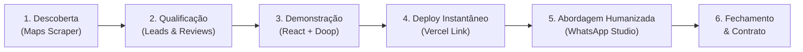

# Prospec Engine — Plataforma Inteligente de Aquisição & Venda de Sites

<div align="center">

**Prospecção de comércios locais, qualificação com dados reais do Google Maps, geração de protótipos de alta conversão e abordagens pelo WhatsApp em uma única plataforma.**

[](https://www.typescriptlang.org/)
[](https://nodejs.org/)
[](https://react.dev/)
[](https://tailwindcss.com/)
[](https://sqlite.org/)
[](#-engenharia-de-software--arquitetura-fullstack)

</div>

---

## 🧭 Visão do Projeto

O **Prospec Engine** é um ecossistema completo de prospecção ativa e venda consultiva de sites para negócios locais (clínicas, barbearias, oficinas, estúdios, restaurantes, pet shops e prestadores de serviço).

Em vez de enviar mensagens frias e genéricas, o operador aborda o comerciante já com uma **demonstração visual de alto padrão da sua própria empresa** (com fotos, avaliações 5 estrelas reais, endereço e botão de WhatsApp funcional), gerando confiança imediata e aumentando drasticamente as taxas de fechamento.

---

## 🏛️ Arquitetura do Workspace

```text
prospec-engine/ (Workspace Raiz)
├── prospec-app/              # Aplicação Central (Dashboard, API REST e Deployer)
├── google-maps-scraper-kit/  # Submódulo: Scraper de comércios locais e auditoria de presença
├── OpenWA/                   # Submódulo: Gateway WhatsApp Baileys para conversas comerciais
├── doop/                     # Submódulo: Canvas visual multiplayer e motor de design
├── scripts/                  # Scripts de automação, medição e deploy em TypeScript
├── src/                      # Geradores de layouts e componentes em TypeScript
├── docs/                     # Especificações, integrações mapeadas e evidências visuais
├── SPEC_SAAS_LOCAL.md        # Especificação detalhada da operação e fases de negócio
├── GEMINI.md                 # Diretrizes estritas de UI, UX, Humanizer e Design System
└── package.json              # Orquestrador de comandos da raiz
```

---

## 🏗️ Engenharia de Software & Arquitetura Fullstack

O projeto foi concebido sob princípios de engenharia de software voltados para alta manutenibilidade, robustez e desacoplamento:

* **Arquitetura Fullstack Unificada:**
  - **Frontend:** SPA reativa em React 18, Vite 6, Tailwind CSS v4, microinterações funcionais com GSAP e roteador client-side com suporte a deep-linking e sincronização com URL.
  - **Backend:** Servidor Express em Node.js 22, servindo a API REST (`/api/*`) e os assets estáticos em porta única (`3333`).
  - **Persistência Relacional:** Banco local com `node:sqlite` nativo (WAL mode e timeout de concorrência), eliminando dependências de build nativo C++ no Windows.
* **Ciclo CRUD Completo & Consistência de Dados:**
  - Operações de *Create, Read, Update e Delete* em todas as entidades do domínio (Leads qualificados, Briefings e Protótipos, Mensagens e Timeline do WhatsApp, Sessões e Histórico de IA no Copilot).
  - Normalização e deduplicação automática de contatos com validação semântica em nível de persistência.
* **Aderência aos Princípios SOLID & Clean Code:**
  - **Responsabilidade Única (SRP):** Separação estrita entre adaptadores de rede (`DiscoveryAdapter`, `MessagingAdapter`, `PrototypeAdapter`), serviços de negócio (`AIService`, `LayoutEngine`, `VercelDeployer`) e repositório de dados (`Repository`).
  - **Aberto/Fechado (OCP):** Motor de layouts extensível por nichos sem necessidade de modificar a lógica central de renderização.
  - **Segregação de Interfaces (ISP):** Contratos tipados em TypeScript (`LeadSummary` vs `Lead`, `ChatMessage`, `Prototype`) para evitar acoplamento desnecessário entre camadas.
  - **Inversão de Dependências (DIP):** Controladores REST acoplados a abstrações e serviços com fallback resiliente (ex: operação fluida mesmo se serviços externos ou Docker estiverem temporariamente offline).
  - **Código Limpo & Defensivo:** Nomes autoexplicativos, funções puras e isoladas, tratamento padronizado de erros e 100% de cobertura em testes automatizados.

---

## 🚀 Como Executar

### 1. Pré-requisitos
* **Node.js 22.19.0+** (necessário para suporte nativo ao módulo `node:sqlite`).
* **npm 10+**.

### 2. Instalação e Execução Direta
A partir da raiz do workspace:

```bash
# Instalar dependências da central
npm --prefix prospec-app install

# Compilar frontend de produção
npm run build

# Iniciar o Prospec Engine
npm start
```

O painel unificado abrirá em **[http://localhost:3333](http://localhost:3333)**.

---

## 💡 Fluxo Operacional de Vendas



1. **Extração Geográfica:** Importação de comércios da Grande BH / RMBH com telefone, endereço, nota média e comentários de clientes.
2. **Triagem Inteligente:** Segmentação automática por nicho e identificação de empresas sem website ou com links desatualizados.
3. **Protótipo Rápido:** Seleção de um dos 8 templates de nicho calibrados para alta conversão (design editorial, sem vícios de IA, com fotos contextuais).
4. **Deploy Vercel:** Geração de um link público real com 1 clique para demonstração no celular do cliente.
5. **Pitch Humanizado:** Criação de mensagem personalizada no tom de voz mineiro, sem travessões nem adjetivos inflados de IA.
6. **Timeline Integrada:** Condução do diálogo diretamente pela aba de conversas do Prospec.

---

## 🤖 Inteligência Artificial & Copilot Estratégico (Claude Sonnet 5)

* **Copilot Contextual (`AiCopilotDrawer`):** Drawer lateral acessível de qualquer tela para análise imediata do comércio com histórico persistido no SQLite.
* **Diagnóstico de Lead com 1 Clique:** Avaliação de fraquezas na presença digital, reputação Google e ganchos comerciais de alta resposta.
* **Gerador de Abordagens Humanizadas:** Geração dinâmica de 3 opções de abordagem personalizadas no WhatsApp calibradas pela skill `humanizer`.
* **Sugestões de Respostas Comerciais:** Contorno de objeções em tempo real na aba de conversas do WhatsApp Studio.
* **Provedor Anthropic / GhostCLI:** Proxy nativo com suporte a chave de API segura, medição de latência e verificação de status online.

---

## 🧪 Comandos Disponíveis

| Comando | Descrição |
| :--- | :--- |
| `npm run dev` | Inicia o Prospec com hot-reload (tsx watch) |
| `npm run build` | Compila o painel cliente Vite para produção |
| `npm start` | Inicia o servidor HTTP da Central na porta 3333 |
| `npm test` | Executa a suíte de testes unitários e de integração |

---

## 🤝 Créditos & Reconhecimentos Open-Source

O **Prospec Engine** integra e orquestra projetos open-source essenciais que viabilizam toda a esteira de prospecção, qualificação e demonstração. Nosso reconhecimento e créditos aos autores e mantenedores:

| Repositório | Autor / Mantenedor | Licença | Função no Prospec Engine |
| :--- | :--- | :--- | :--- |
| [**`google-maps-scraper-kit`**](https://github.com/Mahanaicoach/google-maps-scraper-kit) | Mahan ([@Mahanaicoach](https://github.com/Mahanaicoach)) | MIT | Extração geográfica automatizada no Google Maps, coleta de notas, telefones e reviews reais de clientes. |
| [**`OpenWA`**](https://github.com/rmyndharis/OpenWA) | Yudhi Armyndharis ([@rmyndharis](https://github.com/rmyndharis)) | MIT | Gateway HTTP e servidor de mensageria WhatsApp via Baileys para envio de abordagens e diálogo comercial. |
| [**`doop`**](https://github.com/kgoedecke/doop) | Kevin Goedecke ([@kgoedecke](https://github.com/kgoedecke)) | AGPL-3.0 | Canvas multiplayer e servidor MCP (Model Context Protocol) para renderização de pranchetas visuais e protótipos. |

Cada módulo mantém seu histórico de commits, licença e repositório original preservados em seu respectivo diretório.

---

## 📄 Licença & Propriedade

Projeto proprietário interno voltado para operação local de aquisição e venda de websites.
