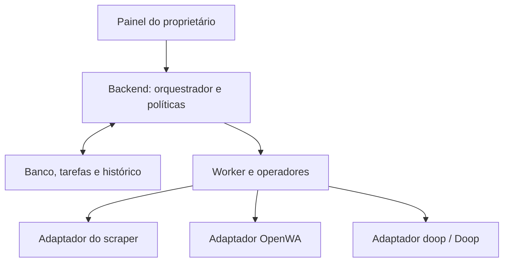

# Spec de implementação: operação local de venda de sites

## Prioridade atual: centralizar os três sistemas

**Escopo da próxima implementação: somente a Fase 0, descrita na seção 13.** Primeiro reunir scraper, OpenWA e protótipos em uma central local utilizável. Os agentes e a automação comercial das demais seções são o roteiro posterior e não devem ser implementados nesta entrega.

“Um único local” significa um ponto de entrada no navegador, uma inicialização documentada, configurações reunidas e dados que possam passar entre os módulos. Os projetos podem manter runtimes, processos e repositórios separados. Reuni-los na mesma pasta ou criar três atalhos é apenas uma parte da centralização.

## 1. Objetivo e contexto

Construir um sistema local para encontrar comércios, organizar oportunidades, conduzir conversas pelo WhatsApp e gerar protótipos de sites para apoiar a venda. O proprietário da operação será o usuário do painel; os comerciantes serão os clientes abordados.

O produto inicial é uma ferramenta interna de aquisição e venda de sites. O termo “SaaS local” descreve a ideia, mas o MVP não exige contas de clientes, assinaturas, multitenancy ou infraestrutura em nuvem.

Estrutura informada pelo proprietário:

```text
money/
  google-maps-scraper-kit/   # descoberta de comércios
  OpenWA/                   # integração com WhatsApp
  doop/               # geração de layouts usando Doop
```

Estes caminhos e papéis foram informados pelo proprietário. APIs, stacks, comandos, formatos de saída e o funcionamento do Doop ainda precisam ser confirmados no código. Esta spec não é uma auditoria dos repositórios.

**Resultado da Fase 0:** operar os três sistemas por uma central local, com status real, configurações, acesso às funções existentes e transferência manual de dados entre eles.

**Resultado posterior:** acompanhar um comércio desde a descoberta até o fechamento, com histórico persistido, tarefas retomáveis e revisão humana nas ações comerciais do MVP.

## 2. Instrução inicial ao Codex/agents

Leia esta spec e os `AGENTS.md` aplicáveis antes de alterar código. Trate esta spec como o escopo do produto e use o código existente como fonte para os detalhes técnicos.

Comece pela inspeção das três pastas. Faça buscas direcionadas em documentação, manifests, entrypoints e integrações; expanda a leitura conforme as dependências encontradas. Preserve alterações locais e o histórico de cada repositório. Confirme se são repositórios independentes antes de definir onde ficará a nova aplicação.

Produza `docs/integracoes.md` com uma tabela que contenha, para cada sistema: stack, entrypoints, comandos verificados, interface reutilizável, autenticação, armazenamento, efeitos externos e limitações. Cite os arquivos que sustentam cada conclusão. Registre separadamente fatos, decisões e pendências.

Depois implemente somente a Fase 0 da seção 13. Avance autonomamente nas partes reversíveis e nos testes locais. Use perguntas apenas quando faltar uma informação que bloqueie a implementação real. Se uma integração estiver indisponível, prossiga com o adaptador simulado e deixe seu estado visível no painel. Encerrar a Fase 0 não autoriza iniciar os agentes ou a automação comercial: apresente a central pronta e deixe as próximas fases documentadas.

Não reescreva os três projetos nem mova suas pastas para padronizar a estrutura. Acrescente uma camada de integração e faça mudanças pequenas nos projetos existentes somente quando necessárias.

**Inspeção concluída quando:** os três sistemas tiverem suas interfaces documentadas e houver um plano concreto para reutilizá-los, incluindo as pendências de Doop e OpenWA. A entrega exige também a central executável e os critérios da Fase 0; a documentação isolada não conclui o trabalho.

## 3. Escopo do MVP

O MVP completo abaixo será construído após a centralização. Nesta entrega, implementar apenas o subconjunto da Fase 0: central, status, configuração, inicialização e operações manuais integradas.

Incluir:

- Painel local com campanhas de prospecção, leads, funil, conversas, protótipos, aprovações e tarefas.
- Importação dos resultados do scraper, normalização e deduplicação.
- Qualificação explicável dos leads e edição manual pelo proprietário.
- Integração de mensagens recebidas e enviadas pelo OpenWA.
- Rascunhos comerciais contextualizados e geração de briefing.
- Geração de protótipo via Doop, revisão visual e envio ao cliente após aprovação.
- Registro manual de proposta, valor, ganho ou perda e próximo passo.
- Persistência, histórico de eventos e recuperação após reinício.

Adiar: pagamentos, contratos automáticos, produção e manutenção completa dos sites vendidos, campanhas em massa, atendimento por voz, múltiplos vendedores e múltiplas contas de WhatsApp. O fechamento comercial registrado no painel não significa que o site final foi entregue ou que um pagamento foi confirmado.

## 4. Arquitetura local

Na Fase 0, o backend centraliza o registro dos serviços e os adaptadores. As ações partem do proprietário no painel. Adicionar orquestrador e operadores posteriormente, aproveitando os mesmos contratos.

Preferir um monólito modular: painel, backend, armazenamento e um worker local. Os operadores são módulos especializados coordenados pelo orquestrador; não precisam de um processo, container ou sessão de modelo por papel.



A stack deve aproveitar o que já existe. Se não houver uma base adequada para o painel, a preferência inicial é TypeScript, React e Node.js, com SQLite para o banco local e fila persistente no próprio banco. Esta é uma decisão de escopo; confirme compatibilidade antes de escolher bibliotecas e versões. Introduza Redis, serviços adicionais ou outro banco apenas se uma limitação observada justificar.

Os projetos atuais podem continuar executando no runtime que já usam. O adaptador encapsula essa diferença. A comunicação pode usar API, comando ou arquivo estruturado, conforme a interface encontrada; não presuma endpoints.

Executar tarefas demoradas no worker, sem bloquear a navegação. Vincular painel e backend ao localhost por padrão. As integrações externas e provedores de IA continuam dependendo de rede; “local” não significa funcionamento integral offline.

## 5. Orquestrador e operadores

Estes são agentes operacionais do produto. Agentes auxiliares que o Codex eventualmente usar para programar são uma decisão de implementação separada.

| Papel | Entrada | Responsabilidade e saída | Limite |
| --- | --- | --- | --- |
| Orquestrador | Eventos, estados, ações humanas e tarefas | Valida pré-condições, agenda o operador, registra o resultado e atualiza o fluxo | Toda transição e todo efeito externo passam pelas políticas do backend |
| Operador de prospecção | Campanha: segmento, localização e limite | Executa/importa scraper, preserva origem e produz leads normalizados | Não envia mensagens nem interpreta telefone público como autorização de contato |
| Operador de qualificação | Lead e evidências disponíveis | Produz prioridade, motivos, lacunas e próximo passo sugerido | Não inventa diagnóstico de site, faturamento ou necessidade do comércio |
| Operador comercial | Conversa, lead, oferta e histórico | Classifica intenção, prepara resposta, coleta briefing e sugere avanço | No MVP, mensagens externas dependem de aprovação; preço e promessas vêm da oferta configurada |
| Operador de prototipação | Briefing confirmado e orçamento de geração | Aciona Doop, registra versão, arquivos e resultado da validação visual | Não apresenta uma imagem como site funcional nem publica ou compartilha automaticamente |

Cada execução recebe um contexto limitado ao trabalho: `task_id`, `lead_id`, versão do estado, objetivo, referências de entrada, ações permitidas, orçamento e prazo. Retorna resultado estruturado, evidências, pendências e sugestões de ação. Sugestões de um modelo não executam ferramentas diretamente.

Use código determinístico para normalização, deduplicação, transições, aprovações e regras de envio. Use IA quando houver interpretação ou criação de conteúdo. Prefira uma solução menor para classificação simples; reserve modelos mais capazes para briefing e decisões visuais que precisem disso. Defina o provedor por configuração, registre consumo quando disponível e sinalize estimativas.

## 6. Jornada e estados

Fluxo comercial padrão:

`novo → qualificado → contato_pendente → aguardando_resposta → em_conversa → briefing_pendente → prototipo_em_preparo → prototipo_em_revisao → prototipo_enviado → proposta_enviada → ganho | perdido`

Regras:

- `novo`: importado, com origem identificada. O proprietário pode descartar ou qualificar.
- `qualificado`: prioridade e motivos registrados. Pode avançar para rascunho de primeiro contato.
- `contato_pendente`: mensagem pronta, aguardando revisão e aprovação.
- `aguardando_resposta`: envio confirmado pelo provedor. Um timeout de envio não confirma esse estado.
- `em_conversa`: resposta recebida e associada ao lead; respostas negativas seguem para encerramento ou bloqueio de contato.
- `briefing_pendente`: há interesse em visualizar uma proposta, mas faltam informações para o layout.
- `prototipo_em_preparo`: briefing confirmado e tarefa de geração criada.
- `prototipo_em_revisao`: artefato gerado, com versão e validação registradas.
- `prototipo_enviado`: mensagem com a versão aprovada teve envio confirmado.
- `proposta_enviada`: condições comerciais aprovadas foram enviadas e registradas.
- `ganho` e `perdido`: definidos explicitamente pelo proprietário, com valor ou motivo quando aplicável.

Manter também `descartado` para lead sem oportunidade e `nao_contatar` para bloqueio. `nao_contatar` deve interromper mensagens pendentes e follow-ups. Uma resposta tardia entra no histórico de um lead encerrado e é sinalizada ao proprietário, sem reabrir a venda automaticamente.

Estados comerciais e estados de tarefas são independentes. Uma falha no Doop marca a tarefa como falha e mantém a oportunidade recuperável. Toda transição registra estado anterior, próximo estado, autor, motivo e data. Correções manuais também seguem essa trilha.

O interesse explícito é o gatilho padrão para gerar um protótipo. O proprietário pode solicitar uma geração antecipada para um lead específico; registrar essa decisão e seu custo. Nunca gerar automaticamente para toda a lista importada.

## 7. Dados e contratos

O banco da aplicação é a fonte do estado comercial. Os projetos integrados continuam responsáveis por suas sessões e dados internos. Evitar escrita direta nos bancos deles; usar as interfaces verificadas.

| Entidade | Conteúdo mínimo |
| --- | --- |
| Campaign | Segmento, cidade/região, limites, filtros e data da execução |
| Lead | ID interno, nome, categoria, endereço, cidade, telefone original e normalizado, site informado, fonte, identificador externo quando existir, evidências, estado e prioridade |
| Conversation | Lead, provedor, identificador de conversa e último evento processado |
| Message | Conversa, direção, ID do provedor, corpo, anexos, datas, status de envio e referência à aprovação |
| Brief | Versão, objetivo do site, público, serviços, identidade, referências, CTA, campos faltantes e confirmação |
| Prototype | Lead, versão do briefing, provedor, estado, tipo de artefato, caminho/URL, captura e revisão |
| Offer / Proposal | Oferta configurada; proposta versionada com escopo, preço, condições e aprovação |
| Task | Tipo, referências de entrada, estado, idempotency_key, tentativas, lease, prazo, erro e resultado |
| Approval | Tipo de ação, alvo e versão, conteúdo aprovado, autor, criação, validade e consumo |
| Event | ID, tipo, origem, correlação, lead/tarefa, payload mínimo e data |
| ContactPolicy | Destino normalizado, elegibilidade e origem dessa avaliação, bloqueio/opt-out, motivo e data |

Permitir valores desconhecidos. Telefone sem país confiável exige revisão, sem presumir DDI. Deduplicar primeiro por identificador de origem quando existir; telefone pode sinalizar duplicidade, mas filiais podem compartilhar contato. Nome, endereço e cidade ajudam a sugerir fusão. Fusões ambíguas exigem decisão humana, preservando as fontes e o histórico.

As interfaces abaixo são contratos internos propostos, não métodos já existentes nos repositórios:

```ts
interface DiscoveryAdapter {
  capabilities(): Promise<DiscoveryCapabilities>;
  discover(input: CampaignInput): Promise<DiscoveryResult>;
}

interface MessagingAdapter {
  capabilities(): Promise<MessagingCapabilities>;
  health(): Promise<ConnectionHealth>;
  send(input: ApprovedMessageInput): Promise<SendResult>;
  reconcile(input: PendingSendInput): Promise<ReconciliationResult>;
}

interface PrototypeAdapter {
  capabilities(): Promise<PrototypeCapabilities>;
  generate(input: ConfirmedBriefInput): Promise<GenerationHandle>;
  status(handle: GenerationHandle): Promise<GenerationResult>;
}
```

Definir os tipos após a inspeção. Cada capacidade pode estar disponível, indisponível ou não configurada. Recebimento de mensagens deve usar o mecanismo realmente suportado pelo OpenWA: eventos, webhook ou polling. Se o provedor não permitir reconciliação de envio, o adaptador retorna essa limitação e o caso vai para revisão.

## 8. Integrações

### Scraper

Reutilizar a extração existente. Validar seu formato de saída e separar captura bruta de normalização. Importar cada execução com campanha e origem. Reimportar o mesmo resultado deve atualizar dados conhecidos sem duplicar leads ou apagar correções humanas. Guardar os campos necessários à operação; uma informação ausente permanece desconhecida.

Qualificação inicial pode considerar adequação de segmento/região, presença de contato utilizável e situação do site quando verificada. Exibir os motivos. “Site não retornado pelo scraper” não comprova ausência de site, e avaliação pública do comércio não comprova intenção de compra.

### OpenWA

Verificar autenticação, sessão, envio, anexos, recebimento e IDs de mensagens. Reutilizar a instância existente. Sessão desconectada deve pausar envios e aparecer no painel.

Persistir eventos recebidos antes de processá-los, deduplicando pelo ID do provedor com o escopo da conta/conversa necessário. Mensagens de números desconhecidos entram em uma caixa de revisão. Um evento repetido não deve produzir resposta ou tarefa duplicada.

Toda saída passa por uma única função de despacho que verifica aprovação, destino, elegibilidade, bloqueio, horário, limites, validade e versão do conteúdo. Essas regras são verificadas novamente no momento do envio. Um contato publicamente listado não é, por si só, consentimento para receber mensagens. A política de elegibilidade será configurada e documentada antes do piloto real, sem prometer que uma configuração torna qualquer abordagem permitida.

### Doop

Descobrir no repositório o que “Doop” significa, como é acionado, quais credenciais usa, seu custo e o artefato retornado. Não substituir silenciosamente por outro serviço nem inventar API. Falta de acesso bloqueia somente a geração real.

O briefing mínimo contém comércio, segmento, objetivo, serviços conhecidos, CTA, referências e identidade disponível. Campos não confirmados ficam como pendência ou placeholder identificado. Não inventar depoimentos, preços, promoções, logotipos ou diferenciais.

Guardar briefing, instrução de geração, resultado e revisão com versões. Para interface renderizável, validar com Playwright no navegador disponível, em desktop e mobile, verificando layout, conteúdo, navegação e erros relevantes. Se existirem, consultar Impeccable, emilkowalski/skills e ui-ux-pro-max-skill antes das decisões visuais. Registrar quais recursos estavam disponíveis; ausência de skill não equivale a revisão concluída.

Se o Doop retornar apenas imagem, validar a imagem e identificá-la como proposta visual. Testes de navegação e responsividade de uma página real ficam pendentes até existir código renderizável.

Um link localhost não é acessível pelo celular do cliente. Para envio, permitir captura/anexo se suportado pelo OpenWA, ou uma URL externa revisada pelo proprietário. Publicação externa é uma ação explícita; o MVP pode funcionar só com capturas. O cliente deve receber indicação clara de que é um protótipo.

## 9. Painel e autonomia

### Central local: primeira entrega

Fornecer um endereço de entrada no navegador. O endereço e a porta serão definidos após verificar os serviços existentes. A central deve ter:

| Área | Funções da Fase 0 |
| --- | --- |
| Visão geral | Status de cada serviço, modo real/simulado, última verificação, falha resumida e ação de recuperação |
| Prospecção | Acesso ao scraper existente; iniciar busca/importar resultado quando a interface verificada permitir |
| Contatos | Lista mínima compartilhada, origem dos dados e seleção de um comércio para a próxima ação |
| WhatsApp | Estado da sessão, acesso à conexão existente e preparação manual de contato com destinatário e texto visíveis |
| Protótipos | Acesso ao gerador existente, formulário manual preenchido com dados do comércio e histórico de resultados |
| Configurações e operação | Endereços, portas, diretórios, credenciais configuradas/ausentes, dependências, logs resumidos e controles disponíveis |

Reutilizar as interfaces atuais onde isso reduzir trabalho. Preferir uma tela nativa da central para as ações que precisam compartilhar dados. Uma interface existente pode ser integrada por proxy/rota somente após verificar autenticação, cookies, assets, WebSocket e caminhos. Usar iframe apenas se for compatível e não prejudicar o fluxo. Caso a interface precise abrir separadamente, identificá-la como acesso externo ao módulo; isso não comprova integração funcional.

A central deve permitir selecionar um resultado do scraper e reutilizar seus dados na preparação de contato no OpenWA e no formulário de protótipo. As ações permanecem manuais. Contatos não devem precisar ser redigitados ou transportados por copiar/colar. Um briefing incompleto pode ser salvo, mas só deve gerar um protótipo após preencher os campos exigidos pela integração. Preparar um contato não dispara uma mensagem.

Separar configuração de conexão dos dados de negócio. Guardar segredos no backend/armazenamento local apropriado; o frontend recebe apenas o estado configurado/ausente e valores mascarados. Alterações de configuração devem ter validação, teste de conexão quando possível e indicação de necessidade de reinício. Reutilizar sessões existentes do OpenWA sem expor arquivos ou chaves no painel.

Fornecer um comando de inicialização da central e das dependências gerenciadas, com diagnóstico de pré-requisitos. O comando real deve respeitar os runtimes encontrados e o ambiente Windows do proprietário. Reutilizar Docker Compose se os projetos já o utilizarem e isso simplificar a operação; não exigir containerizar tudo para concluir a Fase 0.

Verificar serviços já ativos antes de iniciar processos. Distinguir serviços gerenciados pela central de serviços externos. Iniciar/parar/reiniciar somente os processos ou containers pertencentes à central; para os demais, mostrar estado e instrução de operação. Nunca encerrar um processo arbitrário para liberar uma porta. Comandos de gerenciamento vêm de uma lista fixa no backend, sem execução livre de comandos enviados pelo navegador.

Status deve distinguir: não configurado, parado, iniciando, disponível, degradado, desconectado e erro, conforme aplicável. Um processo ativo não comprova sessão WhatsApp conectada ou Doop autenticado. Falha de um módulo deve preservar o acesso à central e aos demais. Manter IDs compartilhados, configurações e resultados após reinício.

### Painel comercial: fases posteriores

Criar estas áreas, com navegação simples:

- **Resumo:** leads por etapa, tarefas em execução, aprovações pendentes, falhas e consumo conhecido.
- **Campanhas e leads:** criação de busca, importação, filtros, qualificação e edição.
- **Detalhe do lead:** dados e fontes, conversa, próximo passo, briefing, versões do protótipo e proposta.
- **Aprovações:** destinatário, texto exato, anexo ou link, versão e botões aprovar/rejeitar/editar.
- **Operação:** saúde das integrações, fila, falhas, retomada e pausa de envios.
- **Configurações:** oferta, provedor de IA, limites, fuso, horários, elegibilidade e modo de execução.

Autonomia inicial:

| Ação | Comportamento padrão |
| --- | --- |
| Normalizar, deduplicar, qualificar e criar rascunhos | Automático dentro de campanha/tarefa iniciada pelo proprietário |
| Atualizar estado após evento confirmado | Automático conforme as transições permitidas |
| Gerar protótipo | Automático após briefing confirmado e dentro do orçamento configurado |
| Enviar primeiro contato, resposta, protótipo ou proposta | Aprovação humana por mensagem no MVP |
| Follow-up | Preparar rascunho somente se habilitado; envio aprovado individualmente |
| Alterar preço, conceder desconto, publicar externamente ou marcar venda ganha | Ação explícita do proprietário |

Uma aprovação vale para uma ação, destinatário e versão exatos. Editar texto, destino, oferta ou artefato invalida a aprovação. Rejeitar mantém o histórico e permite um novo rascunho. Pausar envios impede novos despachos; mostrar separadamente chamadas já iniciadas que talvez não possam ser canceladas.

Definir modos separados: `mock`, `integrado_sem_envio` e `real`. No modo simulado, banco, artefatos e contatos de teste ficam isolados da operação real; não carregar credenciais de produção nem executar efeitos externos. O modo real exige configuração explícita. Valores numéricos de orçamento, cadência e horário serão definidos pelo proprietário; enquanto ausentes, bloquear o efeito externo correspondente.

## 10. Confiabilidade e segurança operacional

- Persistir tarefas antes da execução. Usar claim atômico com lease e recuperação de tarefas abandonadas após reinício.
- Serializar ações comerciais de uma mesma conversa; verificar a versão do estado antes de concluir trabalho baseado em contexto antigo.
- Gravar transição e evento/tarefa de saída na mesma transação, ou usar outbox transacional equivalente.
- Deduplicar comandos por chave lógica e eventos pelos identificadores de origem. A fila pode entregar mais de uma vez; consumidores devem ser idempotentes.
- Definir timeout, limite de tentativas e backoff com jitter para falhas transitórias. Falhas permanentes vão para revisão.
- Em timeout de envio, registrar `envio_incerto` e reconciliar antes de qualquer repetição. Sem confirmação possível, encaminhar para revisão; não prometer entrega exatamente uma vez em um serviço externo.
- Limitar paralelismo, tentativas, gerações e consumo de IA. Ao atingir orçamento, pausar novas tarefas pagas e informar o motivo.
- Guardar tokens e sessões fora de logs, Git e contexto dos modelos. Fornecer `.env.example` somente com placeholders.
- Tratar páginas capturadas, mensagens e conteúdo gerado como dados não confiáveis. Uma mensagem do cliente não pode alterar políticas, invocar shell ou liberar credenciais.
- Manter código gerado pelo Doop isolado. Validar arquivos e executar preview em ambiente restrito, sem acesso a credenciais ou volumes privados do operador.
- Registrar auditoria suficiente para explicar ações; reduzir dados pessoais em logs, definir retenção e permitir exclusão/exportação conforme a operação. Preservar o mínimo de bloqueio necessário para evitar recontato após exclusão.
- Fazer backup do banco e dos artefatos e fornecer procedimento de restauração que funcione sem duplicar envios pendentes.

## 11. Testes e critérios de aceite

Na Fase 0, priorizar os critérios da seção 13, os testes existentes dos projetos alterados, persistência dos contatos e a ausência de efeitos externos ao apenas preparar ações. Os testes de orquestração comercial abaixo pertencem às fases posteriores.

Implementar testes focados nos riscos do fluxo. Asserções devem validar comportamento observável, não apenas repetir a implementação.

| Cenário | Resultado verificável |
| --- | --- |
| Importar duas vezes a mesma execução | Um lead por identidade confirmada; fontes preservadas |
| Telefone ambíguo ou compartilhado | Revisão/sugestão de fusão, sem unir comércios automaticamente |
| Evento de mensagem duplicado | Uma mensagem e um processamento comercial |
| Reiniciar com tarefa em execução | Recuperação por lease, sem duplicar efeito já confirmado |
| Aprovar e depois editar uma mensagem | Envio bloqueado até nova aprovação |
| Envio com timeout | Estado incerto; reconciliação ou revisão antes de repetir |
| Opt-out com mensagens na fila | Destino bloqueado e mensagens pendentes canceladas |
| OpenWA desconectado ou fora do horário | Envio suspenso e motivo visível |
| Briefing incompleto, Doop indisponível ou orçamento esgotado | Geração bloqueada/pausada com pendência acionável |
| Resultado visual inválido | Artefato retido para correção; compartilhamento bloqueado |
| Protótipo apenas em localhost | Não oferecer esse endereço como link acessível ao cliente |
| Conteúdo externo com instruções maliciosas | Nenhuma mudança de política, ferramenta privilegiada ou exposição de segredo |
| Fluxo completo simulado | Lead → conversa → briefing → protótipo → proposta → ganho, com trilha persistida |

Validar o painel visualmente em desktop e mobile com Playwright. Executar lint, checagem de tipos e testes existentes compatíveis com os projetos alterados. Informar os comandos usados, os resultados e o que permaneceu sem verificação real.

## 12. Estrutura sugerida e documentação

Se os três diretórios forem repositórios independentes, criar a aplicação de integração como projeto irmão, sem absorver seus históricos. Organização interna sugerida para esse novo projeto:

```text
prospec-app/
  src/
    app/                 # painel e rotas locais
    domain/              # entidades, transições e políticas
    orchestration/       # tarefas, eventos e coordenação
    operators/           # prospecção, qualificação, comercial e prototipação
    integrations/        # adaptadores e simulações
    services/            # registro, saúde e ciclo de vida dos serviços locais
    persistence/         # banco, migrações e outbox
  tests/
  docs/
    integracoes.md
    operacao.md
    decisoes.md
  .env.example
  README.md
```

Ajustar os caminhos à estrutura real; os limites entre responsabilidades são mais importantes que os nomes das pastas. Manter artefatos, bancos e sessões fora do código versionado. Dados demonstrativos devem ser fictícios.

Documentar no README os comandos reais de instalação, migração, execução, testes e parada. Em `docs/operacao.md`, explicar configuração, aprovações, pausa, falhas, backup e restauração. Em `docs/decisoes.md`, registrar escolhas relevantes e suas justificativas, sem duplicar a referência de comandos.

## 13. Implementação por fases

### Fase 0: central local integrada — executar agora

Implementar nesta ordem, sem desenvolver agentes nesta etapa:

1. **Inventário real:** mapear comandos, portas, sessões, dados, interfaces e dependências de cada projeto. Registrar onde estão os repositórios e quais serviços já estão executando.
2. **Inicialização central:** criar a aplicação de integração, o registro dos três serviços e o comando de execução. Tratar conflitos de portas e serviços externos sem encerrar processos alheios.
3. **Painel único:** disponibilizar navegação, saúde real dos módulos, configurações e acesso às funções existentes. Distinguir integração funcional de um simples link para outra interface.
4. **Dados compartilhados:** importar ou receber o resultado do scraper e persistir contatos com IDs internos. Encaminhar o contato selecionado aos formulários de WhatsApp e protótipo por adaptadores, mantendo origem e resultados vinculados.
5. **Validação manual:** testar o caminho scraper → contato → preparação de mensagem → briefing → geração, respeitando as capacidades reais e sem disparar conversas automaticamente. Se geração real exigir cobrança ou credenciais ainda não fornecidas, demonstrar com mock e manter o bloqueio real explícito.

Critérios de aceite desta fase:

| Verificação | Condição para concluir |
| --- | --- |
| Inicialização | Um comando documentado inicia a central e os serviços sob seu gerenciamento; dependências externas aparecem com instruções verificadas |
| Entrada única | O proprietário acessa o ponto central e encontra os três módulos, seus estados e ações disponíveis |
| Dados entre módulos | Um comércio importado pode preencher uma preparação de contato e um briefing sem redigitação |
| Persistência | Reiniciar a central preserva contatos, origem, configurações e referências dos resultados |
| Falha isolada | Desligar um serviço atualiza seu status e mantém os outros módulos acessíveis |
| Reuso | Serviços já executando são reconhecidos; nenhuma sessão OpenWA ou processo externo é reiniciado sem necessidade |
| Segredos | Chaves e tokens não aparecem em logs, respostas ao frontend ou repositório |
| Efeitos externos | Abrir telas e preparar formulários não envia mensagens nem inicia gerações pagas |
| Evidência visual | Fluxos principais verificados com Playwright, incluindo estados vazio, indisponível e configurado |
| Integração real | Cada módulo indica o que foi validado de fato e o que continua simulado ou bloqueado |

Entregar código executável, documentação dos comandos e uma demonstração do percurso manual. Não apresentar três cartões com links como conclusão da integração dos dados.

### Fases posteriores: agentes e automação — roteiro

1. **Inspeção e contratos:** mapear as três integrações, confirmar limites de repositórios e Doop, criar contratos e simulações. Concluído com evidências por arquivo e pendências explícitas.
2. **Leads utilizáveis:** banco com migrações, importação do scraper, deduplicação, qualificação e lista/detalhe do lead. Concluído quando uma execução puder ser reimportada e consultada após reinício.
3. **Conversa controlada:** adaptador OpenWA, entrada de mensagens, rascunhos, aprovações e despacho central. Concluído com teste de evento duplicado, invalidação de aprovação e envio incerto usando simulações.
4. **Protótipo para um lead:** briefing, adaptador Doop, versões, revisão e preparação do compartilhamento. Concluído quando o fluxo funcionar com adaptador simulado; distinguir claramente a integração real ainda bloqueada.
5. **Orquestração persistente:** ligar operadores por eventos/tarefas e testar recuperação após reinício. Concluído com o fluxo completo simulado e os testes críticos da seção 11.
6. **Piloto integrado:** validar integrações reais com o proprietário. Para mensagens, usar primeiro um destino de teste explicitamente indicado; contatos de comércios exigem o fluxo de elegibilidade e aprovação. Concluído com evidências das chamadas reais e limitações restantes.

Reaproveitar o inventário e os contratos da Fase 0 ao iniciar o roteiro posterior. Inclua persistência e rastreabilidade desde as primeiras entregas; a quinta etapa posterior conecta e verifica o fluxo, sem adiar esses fundamentos. Finalize cada entrega com código executável e um relato curto de mudanças, testes e bloqueios. Evite encerrar apenas com um plano se houver trabalho local possível.

## 14. Definição de pronto

**Entrega atual:** a Fase 0 está pronta quando os critérios de centralização da seção 13 estiverem atendidos e o proprietário puder operar o caminho manual com dados compartilhados. Pendências reais devem permanecer identificadas; mocks não comprovam conexão com os serviços.

**Produto completo, posteriormente:**

O MVP está pronto quando o proprietário consegue iniciar uma campanha, revisar leads, aprovar mensagens, acompanhar respostas, confirmar um briefing, revisar um protótipo, compartilhar a versão aprovada e registrar uma venda, mantendo os dados após reinício.

Uma demonstração com mocks deve estar identificada como demonstração. Só declarar a integração completa quando scraper, OpenWA e Doop tiverem sido verificados de ponta a ponta. Credenciais ou acesso ausentes são bloqueios concretos a relatar, sem impedir a entrega das partes independentes.

### Solicitação para iniciar no Codex

> Implemente somente a Fase 0 da SPEC_SAAS_LOCAL.md na pasta money: reunir google-maps-scraper-kit, OpenWA e doop em uma central local utilizável. Leia os AGENTS.md aplicáveis e inspecione as interfaces reais. Preserve os projetos e crie um ponto de entrada com navegação, configurações, status e inicialização centralizados. Permita transferir os dados de um comércio do scraper para a preparação de contato e para o briefing de protótipo sem redigitação. Reutilize os serviços e interfaces existentes, documentando o que estiver realmente conectado. Ainda não implemente agentes ou automação comercial. Avance nas partes independentes quando faltar uma integração, identifique mocks e entregue a central executável com os critérios da Fase 0 validados. Não envie mensagens reais nem publique protótipos durante o desenvolvimento sem ação explícita do proprietário para o piloto.
